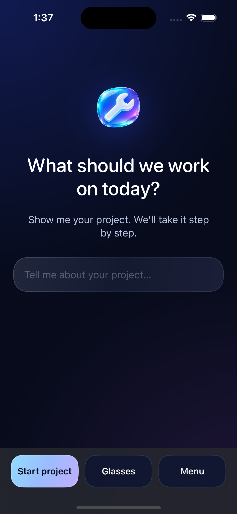
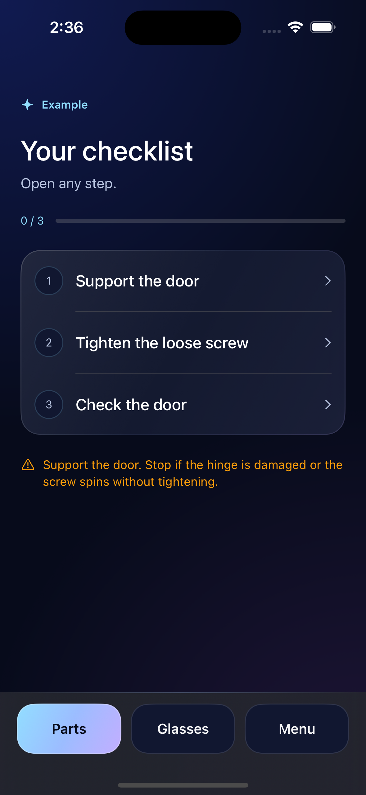
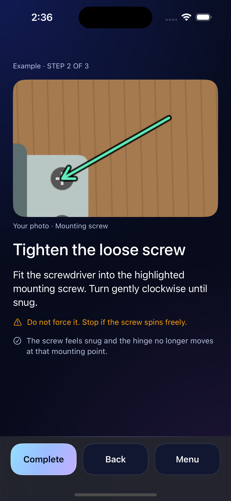

<p align="center">
  
</p>

<h1 align="center">Fixi</h1>
<p align="center"><strong>See the problem. Know the next step.</strong></p>
<p align="center">A visual DIY companion for Meta Ray-Ban Display.<br>Built for the Meta AI hackathon · Native SwiftUI · iOS 17.2+</p>
<p align="center">
  <a href="#try-fixi">Try Fixi</a> ·
  <a href="docs/ARCHITECTURE.md">How it works</a> ·
  <a href="docs/BUILD21.md">Build 21</a>
</p>

Fixi turns “How do I fix this?” into a short, visual checklist. Show what you are working on, describe the problem, and get instructions you can follow with your hands on the project. Ask a question, inspect a close-up, or complete a step by voice, glasses gesture, or phone touch.

**The goal:** less time switching between a repair, a phone, and a tutorial—and a clearer next action.

<p align="center">
  
  
  
</p>
<p align="center"><em>Offline iPhone simulator previews from normal builds 18 and 20. The hinge is a synthetic illustration. These show the design used by build 21, not a live repair or a glasses recording.</em></p>

## A repair, one step at a time

1. **Show and tell.** “I want to replace my engine air filter.” A photo and your words help identify the project. Fixi asks for missing details and marks uncertain make, model, or year guesses for review.
2. **Confirm the project.** Review what Fixi understood before it creates the guide.
3. **Get ready.** See the tools and parts you need. Shopping links stay on the phone.
4. **Follow the checklist.** Open any step. A dot, arrow, or circle identifies a visible target on a still image; bounded crops make small details easier to see.
5. **Keep moving.** Ask for help with the current instruction. Complete it to open the next unfinished step, or go back to the checklist.

When your own images do not show a step, Fixi can look for an attributed example. If no useful image is available, the instructions stay readable on their own.

## Made for the display

| Design choice | What it means while working |
| --- | --- |
| Short instructions and large visuals | Read the next action at a glance. |
| Shared voice, gesture, and touch actions | Use the control that fits the moment. |
| A full checklist, then one focused step | Know the plan without losing your place. |
| Still-image markers | See exactly which photograph a pointer belongs to. These are 2D annotations, not world-anchored AR. |
| Mute mic and pause camera controls | Decide when Fixi can hear or see the project. |
| Three phone layouts | Compare **Focus**, **Flow**, and **Guide** without resetting the repair. |

## Try Fixi

This repository contains **normal Fixi 1.0 (21)**, the camera-enabled version before the recording demo.

**Start with the offline example:** build the app, then choose **Menu → Try an example** on the welcome screen. Alternatively, add `--demo` as a launch argument in Xcode. Explore the illustrated hinge checklist, open a step, and select **Complete** to move on. The local example needs no glasses or API keys and makes no AI request.

**Try a live project with your own keys:** open **Menu → Settings** on the phone. Enter your **Meta Model API key** under **Repair assistant · Meta** and select **Save Meta key**. Add your **OpenAI API key** under **Voice & source lookups · OpenAI**, then select **Save OpenAI key**. Meta powers repair analysis; OpenAI enables spoken replies, source lookups, and online examples. Your accounts need access to the models listed below and cover their usage.

Keys are stored separately in the device Keychain. Enter them privately on the phone; never put them in this repository, an issue, or a screenshot. This build connects directly to the providers and includes no shared developer credentials or hosted backend.

For live glasses use, you need a supported iPhone, Meta Ray-Ban Display, the Meta companion app, and the appropriate Wearables developer access. Simulator previews do not emulate the physical glasses, camera, microphone, or gesture hardware.

### Build locally

```sh
python3 scripts/generate-project.py
open Fixi.xcodeproj
```

Select the **Fixi** scheme and your signing team. The app targets **iOS 17.2+** and pins Meta Wearables DAT **1.0.1**. Follow the [SDK's setup and toolchain guidance](https://github.com/meta/meta-wearables-dat-ios) for your machine. See [build and device setup](docs/BUILD21.md) for signing, registration, previews, and the original provider configuration.

## What powers Fixi

| Component | Role |
| --- | --- |
| **Meta Wearables DAT** | Native glasses camera, display cards, speech transcription, and display selection. |
| **Meta Model API** | Project intake, repair planning, ordinary questions, and locating targets in supplied photos. |
| **OpenAI Responses** | Explicit source lookups and finding relevant, attributed step examples. |
| **OpenAI Realtime** | Spoken narration of the completed answer text. This narration path does not receive camera images or raw microphone audio. |
| **SwiftUI + shared app state** | Phone layouts, checklist progress, local actions, image rendering, and cancellation of stale requests. |

The camera preview runs locally while enabled. AI requests use selected stills. Markers are validated against the exact image used for that request, and the user controls checklist completion. [Read the architecture and data flow →](docs/ARCHITECTURE.md)

## What has been verified

The normal **build 21** passed **431 offline tests with zero failures**, a signed iPhone build, signature verification, and installation with normal launch. Tests cover intake, request validation, photo binding, annotations, navigation, voice-action routing, cancellation, and stale results.

Those results belong to build 21. They do not establish live AI accuracy, physical glasses audio or gesture reliability, or camera performance. [Validation scope →](docs/BUILD21.md#validation)

