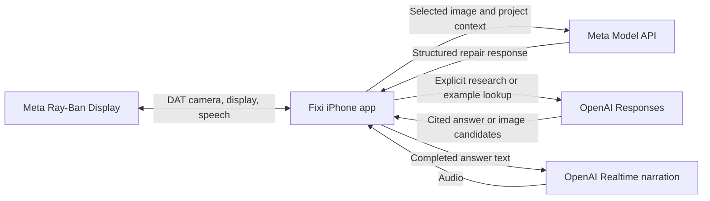

# How Fixi works

Fixi keeps the repair's state on the phone and presents the same available actions to phone touch, voice, and the glasses display. The model suggests instructions and image targets; the app validates the response, owns navigation, and records the user's completion choices.



This is build 21's direct provider flow. Each tester enters their own Meta and OpenAI keys privately in the phone's Settings. Separate device-only Keychain entries hold the credentials. The repository contains no provider credentials and the app has no shared hosted backend.

## The repair state

`FixiModel` coordinates the stages:

```text
Welcome → Intake → Confirmation → Parts → Checklist → Step → Complete
```

Intake collects make, model, and problem in any order. A supported year or generation stays in the model field. Inferences are marked for review, and manual corrections take priority over late results. The app requests a plan only after the user confirms the details.

The plan contains tools, parts, cautions, and ordered instructions. Checklist progress belongs to the user. A shared action registry exposes currently available controls to touch, speech, and native selection. Requests carry context so a late response cannot replace a different project or step.

## Images that belong to the instruction

Every accepted original image has an identity. Grounding responses must name that exact image, supply valid normalized coordinates, and stay within its bounds. A circle, arrow, or dot is rendered on a static copy. Cropping is deterministic, padded, and bounded; it does not alter the evidence sent for analysis.

`MendStepExamples` prepares visuals quietly after planning. It checks retained original photos before looking for an external example. A candidate example must pass the client checks and retain attribution. A missing image leaves the written instruction available. Entering an unresolved step can trigger a bounded fresh-camera target check while live view is enabled.

Camera frames are streamed locally during live view. A selected fresh still accompanies a visual question or target request. The app does not upload a continuous video stream or record that stream to a file. Images used in an answer remain attached to that answer even if the wearer moves.

## Voice and gestures

Meta's native speech capability supplies transcript text. Explicit available commands are routed locally; ordinary repair questions go to Meta with the current project and step context. OpenAI Realtime reads the completed reply in a separate narration request. The narration path sends answer text, not raw microphone audio or camera images.

The app checks the output route before and during playback. Camera use yields during narration and system controls, then resumes only if still enabled. Mute, pause replies, pause camera, end voice, and backgrounding have distinct lifecycle behavior.

Native display focus and pinch handle selection. Build 21 suppresses redundant cards to preserve focus and rejects stale or duplicate card callbacks. Raw Inputs-based swipe-edge navigation is disabled. This is a small 2D display interface; markers do not track physical objects in the world.

## Provider roles

| Work | Build 21 provider | Input |
| --- | --- | --- |
| Identify the project, plan a repair, answer ordinary questions, locate targets | Meta Model API, `muse-wonder-1.0` | Relevant project text and selected image when applicable |
| Look up sources and find example images | OpenAI Responses, `gpt-4.1` with web search | Confirmed project and question; explicit live research can include a selected still |
| Speak the finished response | OpenAI Realtime, `gpt-realtime-2.1-mini`, `marin` | Completed reply text |

These are the identifiers configured in the baseline source; availability depends on the corresponding provider account. Responses requests set `store: false`. That setting is not a blanket statement about provider retention or processing policy.

Source links come from validated citation annotations. Public example-page fetches use an ephemeral session without provider authorization or stored cookies; bounded redirects and public-address checks reduce inappropriate fetches. A public-address DNS preflight is not DNS pinning. Images from the web are examples, not evidence of the user's current project.

## Code map

| Area | Main files |
| --- | --- |
| Project and progress | `FixiModel.swift`, `ProjectIntake.swift`, `RepairCore.swift` |
| Glasses integration | `FixiGlasses.swift`, `GlassesSpeechInput.swift` |
| Actions and conversation | `VoiceActions.swift`, `FixiVoice.swift`, `TranscriptVoiceSession.swift` |
| Parts and shopping | `MendPartsClient.swift`, `MendShoppingLinks.swift` |
| Live images and visual answers | `MendLiveView.swift`, `MendLiveQuestionClient.swift` |
| Step visuals and examples | `MendStepExamples.swift`, `MendPhotoGuideClient.swift`, `MendExampleImageClient.swift` |
| Annotation and crops | `PhotoCanvas.swift`, `PhotoFocus.swift` |
| Research and narration | `MendResearchClient.swift`, `RealtimeSpeechOutput.swift`, `LiveVoiceAudio.swift` |
| Phone interface | `FixiView.swift`, `MendFocusExperience.swift`, `MendFlowExperience.swift`, `MendGuideExperience.swift` |

All files above live in `Fixi/`. [Build 21 validation](BUILD21.md#validation) explains which layers the offline tests cover.
